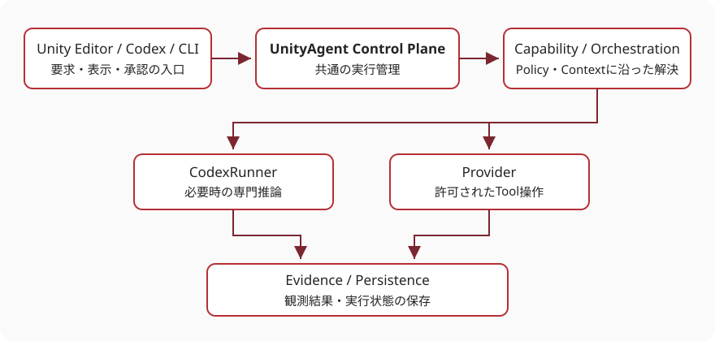

<p align="center">
  
</p>

<h1 align="center">UnityAgent</h1>

<p align="center"><strong>Unity開発を、計画から実行・検証まで。</strong></p>

<p align="center">
  <a href="VERSION"></a>
  <a href="docs/references/capability-status.md#対応環境"></a>
  <a href="https://github.com/DarumaPPAP/UnityAgent/actions/workflows/validate-agent-contracts.yml"></a>
  <a href="LICENSE"></a>
</p>

<p align="center">
  <a href="#install">はじめる</a> ·
  <a href="docs/README.md">ドキュメント</a> ·
  <a href="docs/architecture/architecture.md">アーキテクチャ</a> ·
  <a href="https://github.com/DarumaPPAP/UnityAgent/releases">Releases</a>
</p>

<a id="what-is-unityagent"></a>

## UnityAgentとは

UnityAgentは、Unity Editor・Codex・開発ツールをつなぎ、作業の計画、承認、実行、検証結果の管理を一貫して扱うAI開発基盤です。UnityAgentを共通のControl Planeとして、対象Projectと許可された範囲に沿って作業を進めます。

このREADMEは公開Betaからの導入を案内します。**公開ReleaseとDevelopmentのmainは、同じVersion文字列でも機能が異なります。** 各機能の対象Revisionと未検証範囲は [機能の状態表](docs/references/capability-status.md) で確認できます。

## できること

| 作業 | 利用条件と現在の範囲 |
|---|---|
| Projectと開発環境を調べる | Doctorでツールの状態を確認し、対応する検査経路でProject Factを取得する |
| 専門担当を活用する | 対応Taskと必要な環境・Contextが揃ったときに、任意のSubAgentを選出する |
| 許可した範囲を変更する | 対応する変更経路で対象・Revision・承認を確認する。任意の変更を無条件に実行する機能ではない |
| 検証結果を確認する | 実行結果とEvidenceを記録し、未観測・利用不可・検証済みのGateを区別する |

<a id="architecture"></a>
<a id="provider-model"></a>

## 動作の仕組み



図は理解のための概念図です。Tool操作はProvider、専門推論はCodexRunnerを経由します。正式な5層の責務・依存関係は [アーキテクチャ](docs/architecture/architecture.md) と既存Contractを参照してください。

<a id="install"></a>
<a id="requirements"></a>
<a id="unity-package-manager"></a>
<a id="control-plane-bootstrap"></a>

## はじめる

Windowsの通常導入は、公開Beta **v0.0.8-beta** のUnity Packageから始めます。Unity 6.x+、Git、Python 3.10以上、Windows PowerShell 5.1以上を用意してください。Codexとの連携には別途Codex CLIが必要です。

1. Unity Package Managerの「Add package from git URL」で次を追加する。
2. `UnityAgent > Setup` を開き、Control Planeを導入・検出する。
3. [最初の操作](#quick-start) で診断結果とSetup Planを確認する。

```text
https://github.com/DarumaPPAP/UnityAgent.git?path=/Packages/com.darumappap.unity-agent#v0.0.8-beta
```

SetupのControl Plane Bootstrapは、Packageに対応するRelease成果物をSHA-256検証して導入します。ProjectのUPMとHostの両方を確認してください。[導入ガイド](docs/getting-started/installation.md) にReleaseとDevelopmentの使い分け、更新・修復、Revision確認をまとめています。

<details>
<summary>任意のCodex Pluginを手動で導入する場合</summary>

```powershell
codex plugin marketplace add DarumaPPAP/UnityAgent --ref v0.0.8-beta --json
codex plugin add unity-agent@unity-agent --json
```

導入後は新しいCodexのチャットで開始します。既存Marketplaceとの競合時は上書きせず、Setupの診断・計画・承認経路で確認してください。

</details>

<a id="quick-start"></a>

## 最初の操作

Control Plane導入済みの端末で、対象Unity ProjectのRootを指定します。以下は **v0.0.8-beta用** の構文です。

```powershell
$Project = "D:\Projects\MyGame"
unity-agent doctor --project-path "$Project" --format json --non-interactive
unity-agent setup --operation plan --project-path "$Project" --format json --non-interactive
```

DoctorとPlanはProjectへ変更を適用しません。診断・Plan・EvidenceはState領域へ記録されます。終了コード0は診断操作の完了を表し、全ツールの利用可能や実Unity動作の成功を意味しません。

Planの適用は別の承認付き操作です。[最初のTaskガイド](docs/getting-started/first-task.md) で結果の見方と次の手順を確認してください。Developmentの `uagent` とCWD検出も同ガイドに分けて説明しています。

<a id="responsibility-boundaries"></a>
<a id="統合subagent"></a>

## 専門SubAgent

以下はDevelopmentの現行定義です。いずれも任意導入で、登録だけでは実行可能になりません。

| 専門担当 | 公開Capabilityと権限 |
|---|---|
| ArtistSubAgent | Cameraの検査・限定調整、Visual Capture。変更は対応Backend・Scope・承認が必要 |
| GraphicsSubAgent | Rendering・Shaderの読取専用分析。変更のApply権限は持たない |
| WorldCreatorSubAgent | World Goalから構造化した計画を作る。直接Unityを変更しない |
| QASubAgent | 観測済みの性能Evidenceを分析する。計測・変更適用はUnityAgent側が管理する |

公開 `v0.0.8-beta` ではQA移行前のPerformanceSubAgent名称です。mainの正本IDは `qa_subagent` で、旧 `performance_subagent` は入力互換名として扱います。[選出・必要環境・検証状態](docs/guides/subagents.md) を参照してください。

<a id="core-principles"></a>
<a id="request-lifecycle"></a>

## 安全性と検証結果

- **変更の制御**：対象・Scope・Revisionに結び付いた承認を確認して適用する。
- **必須条件の保持**：環境・権限・Evidence条件が不明または不足なら、条件を弱めて成功扱いしない。
- **証拠に基づく確認**：実行完了と検証完了を区別し、Runtimeの観測をPersistenceへ保存する。

Compile、Editor、Player、実機、Visual、Performanceは別のGateです。一部のPASSから他の成功を推測しません。詳しい契約は [検証とEvidence](docs/architecture/architecture.md#8-evidence-contract) にあります。

<a id="current-production-surface"></a>
<a id="status--license"></a>

## 対応環境と現在の状態

UnityAgentは **Beta** です。Unity 6.x+のBuilt-in・URP・HDRPを対象としますが、これは全環境での実Editor検証済み宣言ではありません。Unity 2022.3の記録は履歴であり、現行Production対応には含みません。

Developmentには限定C#修正や別Workspaceの最大2worker実行が実装されています。限定並列は既定無効で、実モデル・実UnityのE2Eと性能評価は未完了です。固定E2E、追加Backend、画面録画も、それぞれの条件・検証状態を [機能の状態表](docs/references/capability-status.md) で区別します。

<a id="canonical-sources"></a>
<a id="local-reference-navigator"></a>

## ドキュメント

| 読者・目的 | 入口 |
|---|---|
| 導入と最初の操作 | [導入](docs/getting-started/installation.md) · [最初のTask](docs/getting-started/first-task.md) |
| 専門担当と利用可否 | [SubAgent](docs/guides/subagents.md) · [機能の状態表](docs/references/capability-status.md) |
| 仕組みを短時間で知る | [3分で分かる全体構造](docs/architecture/three-minute-architecture.md) |
| 開発・設計を調べる | [全体構造](docs/architecture/architecture.md) · [ローカル開発](docs/local-project-development.md) · [文書一覧・正本案内](docs/README.md) |
| Contextや参照資料を調べる | [Context Explorer](https://darumappap.github.io/UnityAgent/) · [Explorer説明](docs/context-explorer.md) · [Local Reference Navigator](docs/architecture/local-reference-navigator.md) |

<a id="branch-workflow"></a>
<a id="validation"></a>

## 開発への参加

[Branch Policy](docs/development/branch-policy.md) と [PR記述規約](docs/development/pull-request-standards.md) を確認してください。Repositoryの基本検証は次のコマンドです。

```powershell
python tools/validate_all.py
```

依存導入、Unity Project、Hostと実Unityの検証手順は [Unity開発・検証環境仕様](docs/development/unity-test.md) にあります。CIの契約・Host検証と実Editor・実機の成功は区別します。

## ライセンス

[MIT License](LICENSE) で提供します。Beta段階のため、正式版までに互換性のない変更を含む可能性があります。
