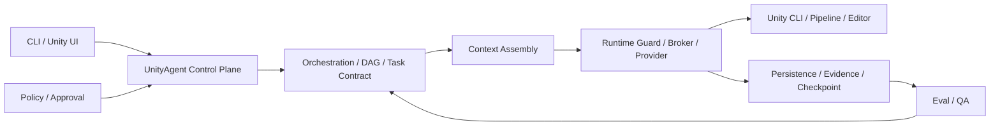

# Production E2Eの設計判断と実装監査

承認済み仕様は [approved-goal.md](approved-goal.md)。Q-001〜Q-014（Q-007はBlender MCP First）は同文書を正本とする。2026-10-16時点の取得結果とDefinition Revisionは [baseline.json](baseline.json)。これは将来の実行成功を表すものではない。

## 基準状態の監査

|領域 / 正本|状態|確認した実装と不足|
|---|---|---|
|Control Plane / `control_plane/unity_agent_control_plane.py`|部分実装|単一EntryのPolicy→Context→Broker→Evidenceあり。複数Taskの実行は未接続|
|Adaptive / `orchestration/routing/adaptive_execution.py`|実装済み・実環境未検証|Fast / Standard / Orchestrated選択。Production複数Task比較は未観測|
|DAG / `orchestration/graph/resource_planning.py`|部分実装|依存・競合Batch計画のみ。成功依存の実行Gateが必要|
|Approval / `persistence/approval/approval_store.py`|実装済み・実環境未検証|永続承認と取消Epoch。新操作は既存Scope検証を再利用する|
|排他制御 / `runtime/guardrails/project_lease.py`|実装済み・実環境未検証|ホストOSの排他はControl Planeの協調排他、Runtime LeaseはEditorへの実行境界で使用する。独自Lock追加を避ける|
|Checkpoint / `persistence/checkpoint/checkpoint_store.py`|実装済み・実環境未検証|Stateのみ復元。Unity Assetを復旧しない。Resumeには外部副作用照合が必要|
|Acceptance / Task Contract|部分実装|Evidence最低条件あり。Task開始時のRequired Gate固定とRevision拘束が必要|
|Staging / Rollback|未実装|変更前/後Hashとmeta/GUID照合を伴う限定復旧が必要|
|SubAgent配布|実装済み・実環境未検証|同居、明示選出、任意有効化。既存の処理を再実装しない|
|QA|未実装|Performance分析は実装済み。QAへの再編と旧ID移行が必要|
|WorldCreator|部分実装|`world.plan`のreasoningのみ。Blender実制作は未実装|
|Blender Session / Job|未実装|MCP経由の制限Template、Job identity、曖昧Timeoutからの再送防止が必要|
|Optional Doctor|部分実装|既存Installer経路あり。Blender MCP / CLI Loop観測が不足|
|Unityでの一連の検証|実装済み・実環境未検証|固定Cubeの検証とPlay・Timeline動画。岩FBXからPrefabまでの一連の検証とは区別する|
|Hot Reload / 実測比較|未実装|Optional Adapterと部分失敗拒否、通常Compileとの測定が必要|
|G1 / G2 / G3|実装済み・実環境未検証|既存Artist fixtureは今回のUnity 6.3岩E2E証拠ではない。各Gateを独立に記録する|

ここでの実装・検証状態は実行結果に応じて更新する。静的な契約テストや模擬動作の成功を、実環境での成功に置き換えない。過去の2026-09-04レビューのUA-Q番号と今回のQ番号は別体系。

## 監査時点の実行構造

新しい実行手段はRuntime層へ追加し、別のControl Planeを作らない。QAは実行順序の判断層へ判定材料を返し、ツールを直接実行しない。

## 回帰テストと受け入れ条件

|段階|自動検証|実環境で必須の確認|
|---|---|---|
|0|正本、Revision、main/PR/CI照合|なし|
|1|DAG順序、失敗依存停止、Gate削除拒否、Evidence/Revision不一致、Resume、Scope、Retry上限、Rollback競合|Editor手動操作との競合|
|2|旧ID移行、性能分析維持、MCP protocol、Session/Job排他、Timeout再送拒否、任意Python拒否、optional不在|Blender MCP実制作とFBX検査|
|3|Fixture、Runner、誤PASS拒否、GUID維持とRollback契約|Unity 6000.3.x URP compile/import/prefab/scene/visual/video/rollback|
|4|部分Hot Reload拒否、Revision拘束、サンプル整合、median/p95、token unmeasured|Play動作、通常Compile、G2実Project、G3 Player/Device|

Baseline試行はPYTHONPATH未設定でImportError。`PYTHONPATH=src`で再実行する。環境制限由来の失敗と実装回帰を区別し、結果は最終実行記録へ保存する。
