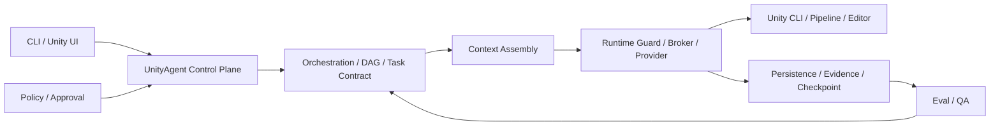

# Production E2E Decision / 実装監査

承認済み仕様は [approved-goal.md](approved-goal.md)。Q-001〜Q-014（Q-007はBlender MCP First）は同文書を正本とする。2026-10-16時点の取得結果とDefinition Revisionは [baseline.json](baseline.json)。これは将来の実行成功を表すものではない。

## Baseline監査

|領域 / 正本|状態|確認した実装と不足|
|---|---|---|
|Control Plane / `control_plane/unity_agent_control_plane.py`|Partially Implemented|単一EntryのPolicy→Context→Broker→Evidenceあり。複数Taskの実行は未接続|
|Adaptive / `orchestration/routing/adaptive_execution.py`|Implemented but Unverified|Fast / Standard / Orchestrated選択。Production複数Task比較は未観測|
|DAG / `orchestration/graph/resource_planning.py`|Partially Implemented|依存・競合Batch計画のみ。成功依存の実行Gateが必要|
|Approval / `persistence/approval/approval_store.py`|Implemented but Unverified|永続承認と取消Epoch。新操作は既存Scope検証を再利用する|
|Lease / `runtime/guardrails/project_lease.py`|Implemented but Unverified|#193のHost OS lockはControl Planeの協調排他。#192のRuntime leaseはEditor dispatch境界。独自Lock追加を避ける|
|Checkpoint / `persistence/checkpoint/checkpoint_store.py`|Implemented but Unverified|Stateのみ復元。Unity Assetを復旧しない。Resumeには外部副作用照合が必要|
|Acceptance / Task Contract|Partially Implemented|Evidence最低条件あり。Task開始時のRequired Gate固定とRevision拘束が必要|
|Staging / Rollback|Not Implemented|変更前/後Hashとmeta/GUID照合を伴う限定復旧が必要|
|SubAgent配布 / #193|Implemented but Unverified|同居、明示選出、optional activation。再実装しない|
|QA|Not Implemented|Performance分析は実装済み。QAへの再編と旧ID移行が必要|
|WorldCreator|Partially Implemented|`world.plan`のreasoningのみ。Blender実制作は未実装|
|Blender Session / Job|Not Implemented|MCP経由の制限Template、Job identity、曖昧Timeoutからの再送防止が必要|
|Optional Doctor|Partially Implemented|既存Installer経路あり。Blender MCP / CLI Loop観測が不足|
|Unity E2E / #194|Implemented but Unverified|固定Cube ProbeとPlay/Timeline動画。岩FBX→PrefabのE2Eではない|
|Hot Reload / 実測比較|Not Implemented|Optional Adapterと部分失敗拒否、通常Compileとの測定が必要|
|G1 / G2 / G3|Implemented but Unverified|既存Artist fixtureは今回のUnity 6.3岩E2E証拠ではない。各Gateを独立に記録する|

ここでのVerified分類は実行結果により更新する。Static ContractやMock成功をProduction Verifiedへ昇格しない。過去の2026-09-04レビューのUA-Q番号と今回のQ番号は別体系。

## 現行Architecture

新BackendはRへ追加し、別のControl Planeを作らない。QAはOrchestrationへ判定材料を返し、直接Dispatchしない。

## 回帰 / Acceptance Matrix

|Phase|自動検証|実環境必須Gate|
|---|---|---|
|0|正本、Revision、main/PR/CI照合|なし|
|1|DAG順序、失敗依存停止、Gate削除拒否、Evidence/Revision不一致、Resume、Scope、Retry上限、Rollback競合|Editor手動操作との競合|
|2|旧ID移行、性能分析維持、MCP protocol、Session/Job排他、Timeout再送拒否、任意Python拒否、optional不在|Blender MCP実制作とFBX検査|
|3|Fixture、Runner、誤PASS拒否、GUID維持とRollback契約|Unity 6000.3.x URP compile/import/prefab/scene/visual/video/rollback|
|4|部分Hot Reload拒否、Revision拘束、サンプル整合、median/p95、token unmeasured|Play動作、通常Compile、G2実Project、G3 Player/Device|

Baseline試行はPYTHONPATH未設定でImportError。`PYTHONPATH=src`で再実行する。環境制限由来の失敗と実装回帰を区別し、結果は最終実行記録へ保存する。
